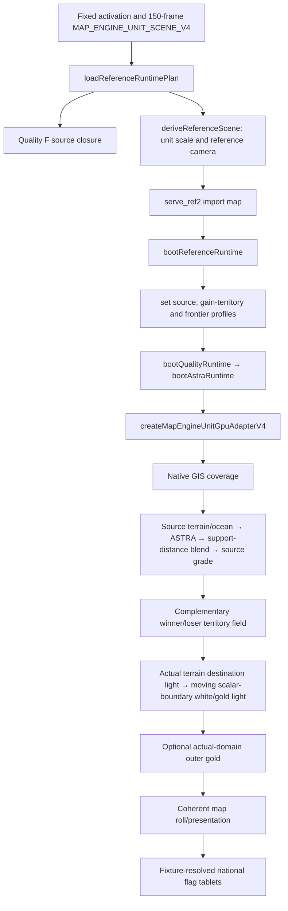
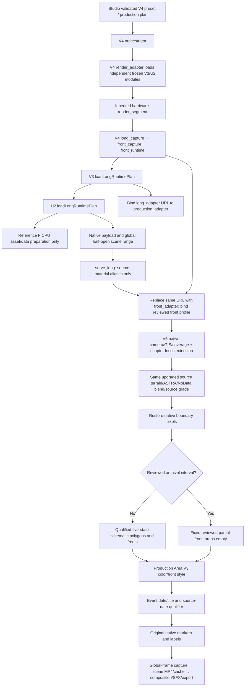

# End-to-end map and rendering trace

Audit source: `c0f2868e9cab8a269c2bd8552dc09920e5e53863`. All paths below are relative to `world-simulation-shorts-engine/`. This is a source and packaged-closure audit. No GPU context, SwiftShader draw, render, paid deployment, or current 80-second output inspection was performed by this audit.

## The decisive result

The current Studio V4 80-second route **contains the older five-second high-quality source closure but does not boot that five-second expression graph**. It reuses its ASTRA/source-material factories, then selects a separate supplied-polygon/archival-line compositor, conservative chapter camera, and original native graphics. This is explicit source behavior, not evidence that the advanced code disappeared from the operating image.

`recovery/universal-auto-video-v2/long_runtime.mjs:1-3,85-88` states that the inherited five-second scene is never booted or time-warped and supplies the asset/data closure only. Lines 124-127 replace its bootstrap with the long-video plan and disable the five-second domain-coverage registration. The operating image inclusion evidence is recorded separately in `IMAGE_AND_BASELINE_LINEAGE.json`; inclusion must not be confused with selected execution.

## Five-second advanced route

Exact invocation and import edges:

| Edge | Evidence |
|---|---|
| Node derives enlarged units and candidate camera | `recovery/reference-visual-master-v2/ref2_runtime.mjs:49-57,69-98` |
| Production requires integrated F rather than arbitrary A/B test | Same file `60-64,127-131` |
| Server installs material, territory and frontier aliases | `recovery/reference-visual-master-v2/serve_ref2.py:18-25` |
| Browser registers three expression profiles and boots the Quality route | `recovery/reference-visual-master-v2/ref2_adapter.mjs:12-33` |
| Quality selects territory/material decorators then ASTRA boot | `recovery/visual-quality-upgrade-v1/quality_adapter.mjs:6-14` |
| ASTRA boot compiles the five-second control and reference camera | `recovery/astra-gpu-activation-v1/astra_adapter.mjs:22-42` |
| Actual V4 factories: terrain, territory, frontier, presentation, national tablets | `web/map_infographic_v1/map_engine_unit_gpu_adapter_v4.mjs:123-139` |
| Actual draw order and terrain-texture reference in frontier light | Same file `152-178`; `actualTerrainTexture:terrain.outputTexture` at `174` |
| Frontier light follows the same evaluated ownership boundary and fades on measured stops | `web/map_infographic_v1/reference_control_frontier_light_v3.mjs:46-74,119-130,207-226` |

The candidate commit `1b8ef6e0816ae3239d9c889b5ab4e91b170c8e90` is the saved `map-engine-unit-bundle-v1` five-second candidate, not an 80-second Korean War product. Its `fixtures/SCENE_PLAN.json:15-16,29-34,36-42` explicitly identifies a modern counterfactual visual study, private historical-policy tests, and no assertion of surveyed military units. That fixture contains 8 national tablets, including modern Russian/US profiles. Those positions and flags must not be transplanted into a historical Korean War timeline as fact.

The later Reference V2 F path adds bounded style overrides on top of that family. Its settings are real scene/profile controls, not an unrestricted Studio natural-language command language. `ref2_profiles.mjs:12-29,53-79` defines their limits and explicitly marks event retiming/new event hold unsupported.

## Current 80-second V4 route

Exact native capture redirection (not mere filename inference):

1. `recovery/verified-front-data-v4-recovery/render_adapter.py:25-30` loads the frozen V3 hardware adapter into an independent module instance and changes that instance's `HERE` to the V4 extension directory. `prepare_job`/`render_segment` at `61-73` reuse its GPU admission and render implementation.
2. `recovery/universal-production-v3/render_adapter.py:20-33` similarly loads the fixed U2 parent and binds its capture target to the V3 directory. The V4 selection supersedes that instance only; protected module source is unchanged.
3. `recovery/universal-auto-video-v2/render_adapter.py:189-222` runs `node HERE/long_capture.mjs` with the actual plan SHA, selected scene, GPU admission, and output root. It checks UID/GID, immutable digest, shared GPU lease, remaining policy time, native NVIDIA admission, VRAM growth, and receipt hashes (`52-77,126-185,223-250`).
4. `recovery/verified-front-data-v4-recovery/long_capture.mjs:8-31` binds the reviewed front profile/manifest before invoking `front_capture`. `front_capture.mjs` and the preserved U2 capture retain global frame/capture/encode validation.
5. `recovery/verified-front-data-v4-recovery/front_runtime.mjs:15,39-59,61-92` first loads the V3 plan, then **replaces** `/universal/long_adapter.mjs` with `front_adapter.mjs`, binds `/front-v4/front_visual.mjs` and SHA-bound `/front-v4/profile.json`, and verifies every GeoJSON equals its profile geometry. The replacement is a URL-to-hash-bound-source binding, not a runtime rewrite of protected source.
6. `recovery/universal-production-v3/long_runtime.mjs:24-30,94-112` supplies the intermediate production binding. U2 `long_runtime.mjs:75-133` loads the Reference closure, then supplies actual long-plan/native inputs. `serve_long.py:22-34` selects only terrain aliases and boots the currently bound `/universal/long_adapter.mjs`.
7. Browser `front_adapter.mjs:25-77` validates the actual profile, authentic ASTRA, NVIDIA backend, builds one held Area plan for each reviewed front, and creates the native/terrain/production overlay/annotation owners. Its `drawFrame` (`92-142`) is the current compositor.

## Which advanced features survive into 80 seconds?

| Five-second component | Current V4 80-second selection | Consequence |
|---|---|---|
| SHA-verified base terrain/ocean source | Reused through `createReferenceTerrainMaterialPassV4` | Present in selected path; unsupported regions still fall back to source material. |
| Actual ASTRA surface/height/signed bathymetry | Reused through the source factory and upload bundle | Present; partial source support, real GIS coast masks and NoData remain essential. |
| Per-role support-distance edge blend and source grading | Reused via reference source material → quality factory | Present. It is incorrect to diagnose all lost quality as missing ASTRA or an old image. |
| Complementary purple/red winner/loser ownership field | Replaced by explicit supplied Area V3 polygons | No inferred enemy complement; palette differs. |
| Gained-territory style decorator | Not called by current long compositor | The five-second `gain_territory` effect does not follow automatically from asset closure. |
| Moving scalar-boundary light with destination terrain lighting | Not called; Area V3 FRONT style selected | No existing scalar motion/stop oracle or actual-terrain-texture input in this selected front pass. |
| Domain outer-gold effect | Explicitly disabled (`registerDomainCoverage:false`) | The older domain glow is neither an archival front nor automatically enabled by a “gold” prompt. |
| Reference camera keyframes/roll/read hold | Replaced by chapter focus over V5 | Current camera pans/widens conservatively; it does not reproduce the five-second roll/zoom track. |
| Original national flag/role tablets and safe size selection | Not instantiated | Current native markers/labels remain; adding arbitrary historical unit positions is forbidden. |
| No-text scene | Replaced by date/title and “approximate/partial” qualifiers | More text is deliberate source qualification in V4, not the no-text five-second style. |

Source for the overlay split: `production_area_pass.mjs:4-27`, `production_visual_profile.mjs:7-44`; the code explicitly reports `scalarV2ClassifierReused:false` and `originalV2ScalarClassifierApplicable:false`. V4 `front_adapter.mjs:102-105` selects `ARCHIVAL_FRONT_HOLD` with `areas:[]`, and `front_visual.mjs:65-78` forbids unobserved movement/occupation inference.

The stored 80-second plan has 12 chapters/2400 frames, 19 explicit geometry-clock rows over the existing five schematic states, 5 qualified held-core area bindings, and no historical unit positions. Its eight archival-front schedule rows cover `[1550,2400)`, or the final 850 frames / 28.333… seconds. During those intervals the selected data deliberately contains only reviewed partial UN front lines, not complete opposing occupation polygons. These counts are inspection of stored JSON, not a claim that the current deployed job produced those pixels.

## Data and visual limits relevant to handoff

- `web/map_infographic_v1/reference_terrain_material_v4.mjs:1-4,166-175`: baseline relief is registered baked RGB. Warm treatment is bright-feature tone treatment, not reconstructed terrain or a physical contour-light mesh.
- `recovery/astra-gpu-activation-v1/astra_material_core.mjs:20-45,62-95`: ASTRA elevation supplies physical finite-difference normals for fragment lighting; signed negative bathymetry is additionally gated by actual ocean coverage. This is material shading, not an asserted displaced 3D terrain mesh or fluid simulation.
- `recovery/visual-quality-upgrade-v1/quality_material_core.mjs:20-74,101-110`: actual source/validity support distances control material blending; native GIS coast coverage is not blurred. Original values are not invented outside their support.
- `recovery/astra-gpu-integration-v1/gpu_upload.mjs:44-49,69-89,101-118`: R32F terrain, R16I signed bathymetry, RGBA8 color and R8UI validity preserve original row order and native nearest-cell sampling. Uploaded source CRS is currently rectilinear EPSG:4326; arbitrary projected inputs require upstream conversion/adapter support, not assumed browser compatibility.
- `web/map_infographic_v1/reference_ocean_material_v4.mjs:1-5,15-17,36-37,68-78`: baseline ocean is source-tone appearance; procedural ripples/glints/drift are explicitly zero and enabling them is rejected. ASTRA depth coloring is genuine where supported but does not add wave physics.
- `recovery/astra-gpu-activation-v1/prepare_activation.py:105-127,143-166`: production preparation selects the pinned source profile/archive. Existing CPU regional-provider generality does not mean current Studio can request and render arbitrary worldwide high-resolution data from a free-text place name.
- `web/map_infographic_v1/national_unit_badge_v1.mjs:10,46-62,149-171`: the current national-unit engine creates original vector tablets, roles GROUND/AVIATION/SUPPORT, supplied resolved anchor/size/rotation frames. It is not a tank/ship/infantry physics engine, a combat simulation, or source-video icon extraction. These national tablets are not called by the current V4 80-second compositor.

## What this audit does not prove

Operating-image membership is proved by immutable build/pull evidence, source invocation by the graph above. Neither proves quality parity with the reference or successful current RTX 5090 output. A supplied screenshot or historic PASS record is not a current full 80-second MP4. Current full-output verification remains `NOT_VERIFIED` until the actual artifact, decode, manifest, execution signature and image/profile match can be checked.

## CPU data APIs versus automatic worldwide Studio acquisition

The completed CPU source/provider code is reusable; the current Studio image's selected preparation uses the pinned ASTRA archive and profile. These are different capability levels. Source existence, request generation, real download receipt, GPU material activation and full output verification must each be recorded separately.

| Existing CPU API | Actual behavior and limits | Source evidence |
|---|---|---|
| `parse_terrain(bytes, expected_sha256=..., vertical_datum=...)` | Single-band Float32 geographic GeoTIFF, metres; preserves original values/NoData/row order. GDAL-corrected PixelIsPoint transform gets no second half-pixel shift. Rectilinear eastward columns only. | `recovery/astra-cpu-data-v1/astra_cpu/terrain.py:26-38,54-126` |
| `parse_bathymetry(bytes, ...)` | libnetcdf raw signed positive-up metre elevations; preserves cell centres, native latitude direction, fill values and unresolved vertical datum. Rejects unresolved/non-EPSG:4326/projected or packed grids. Negative land is not inferred ocean. | `astra_cpu/bathymetry.py:235-255,280-345,350-373` |
| `depth_with_ocean_mask(raster, ocean_mask)` | Requires aligned explicit boolean ocean mask; derived non-ocean/NoData samples remain unsupported NaN, not zero depth. Browser material instead uses the existing same-frame native GIS ocean fraction. | `astra_cpu/bathymetry.py:375-404`; `astra-gpu-activation-v1/astra_material_core.mjs:39-45,88-95` |
| `parse_surface(PNG, worldfile, projection, ...)` | Raw PNG/color metadata and exact sidecar hashes; `.pgw` C/F are pixel centres, converted once to corners. Geographic degree grids only, no implicit reprojection. | `astra_cpu/surface.py:53-106,159-233` |
| `TerrainSource`, `BathymetrySource`, `SurfaceTextureSource`, `ArchiveCatalog` | Source/version/license/SHA-bound results with `available`, `unavailable`, `auth_required`, `version_changed`, `license_unverified`, `invalid_data`. Requested/output/source resolutions are distinct; no numeric resampling is implied by target resolution. | `astra_cpu/providers.py:13-35,39-105,108-218,224-302` |
| `plan_copernicus_tiles`, `plan_cog_ranges` | Select actual supplied index intersections; bounded metadata/Range requests. COG range planning requires supplied object-bound IFD/layout metadata, does not discover offsets or decode arbitrary partial TIFFs. Unknown tiles are not synthesized. | `astra_cpu/acquisition.py:257-305,374-406` |
| `parse_gebco_metadata`, `plan_gebco_subset`, `parse_gebco_ascii` | Version/metadata identity; requires actual complete coordinate vectors before elevation subset selection; inclusive DAP indices retain source latitude direction. Missing axes cause coordinate-only requests, not a global elevation download. | `astra_cpu/acquisition.py:583-647,653-726,808-930` |
| `parse_wmts_metadata`, `plan_wmts_tiles`, `build_wms13_plan` | Supplied capabilities/tile-matrix metadata and bounded requests. WMS 1.3 EPSG:4326 service BBOX is latitude/longitude while internal BBOX remains west/south/east/north. Output dimensions do not increase source detail; dateline parts are split. | `astra_cpu/acquisition.py:949-970,970-1102,1104-1213,1216-1281` |
| `FileCache`, `DownloadManager` | Source/version/bbox/CRS/resolution/hash/metadata/URL/range/ETag cache identity; raw/transformed cache, single-flight, corruption checking, explicit safe resume and bounded concurrency/time/retries. Default networking is disabled and must be granted with an allowed-host set. Failed receipt cannot become a successful artifact. | `astra_cpu/cache.py:122-188,285-504,648-677,679-705,969-1018` |
| `prepare_scene(scene, sources)` | Optional `mapData` validates explicitly supplied identities/bbox/CRS/cache policy; returns unchanged renderer scene plus CPU preparation configuration. Absent/disabled settings preserve old behavior. Does not resolve countries, fetch metadata, authorize licenses/network, choose a camera or activate GPU by itself. | `astra_cpu/scene.py:140-218` |

These functions implement meaningful worldwide-coordinate/request contracts, including explicit dateline handling, but the current `VERIFIED_FRONT_V4_80S` production preset does not expose automatic worldwide source discovery/download from a natural-language topic. The active `prepare_activation` reads `ESSENTIAL_MAP_SAMPLES.zip` and the pinned `SCENE_MAP_DATA.json`. Declaring “global ASTRA automatic acquisition active in Studio” would exceed the call-path evidence. Existing historic CPU tests may be consulted; they were not rerun wholesale in this audit and do not prove a new external download occurred.
