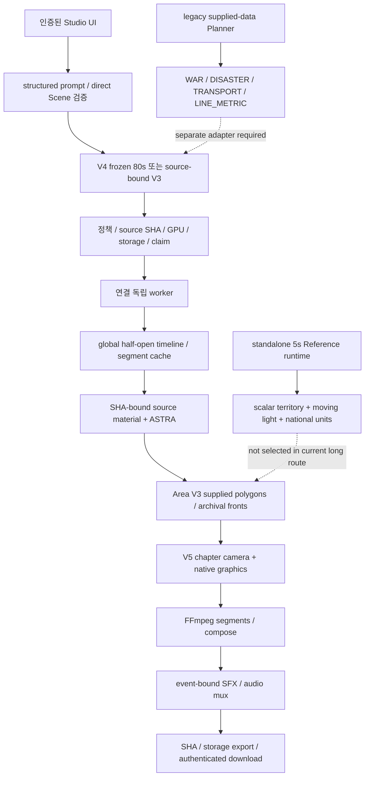

# 기능 의존성과 조합 가능 범위

기준은 `AUDIT_BASELINE.json`이다. 아래 화살표는 코드 호출·데이터 의존성이며 GPU 실행 관측이 아니다. 엔진이 이미지에 있어도 선택된 adapter가 호출하지 않으면 최종 화면에 나타나지 않는다.

| 조합 | 필수 데이터·호출 | 현재 경계 |
|---|---|---|
| ASTRA + Area + native graphics | pinned terrain/surface/bathymetry, validity support, native coverage, source factory, supplied Area data | 현재 장편 선택 경로에 있음. 임의 국가 자동 수집 활성화를 의미하지 않음. |
| V4 archival front | reviewed GeoJSON/profile/manifest + source-date qualifier + exact partial line | 앞뒤 원문 날짜 사이의 실제 점령 영역을 추정하지 않음. active 구간은 areas 비움. |
| 5초 scalar territory + frontier light | complementary control plan, scalar boundary, actual terrain texture, gain/light factories | 코드 포함. current long path 미호출. 임의 다중 역사 전선을 같은 scalar로 변환하면 의미 왜곡 위험. |
| national flags/role tablets | dated faction/unit anchors, original asset, all-frame safe size/layout | 5초 fixture 존재. current80s historical positions 비어 있음. 현대 가상 배치를 복사할 수 없음. |
| Flow route/object/pulse | geographic route, object role/graphic, timing, projection/arc-length | 독립 FINAL/Planner 경로. current WAR long selection 미연결. route sampler 재사용이 full Flow 실행을 뜻하지 않음. |
| Event line + metric | supplied line, truthful metric, layout/occlusion, detail lock | arc-length/glyph/layout 일부 재사용. Suez sequence 전체는 current80s에 미선택. |
| Wave/impact | supplied source/coast/impact data, Wave profile, Area timeline | 독립 Area/Wave 경로. 전쟁 preset에 요청 문자열만 추가해 켤 수 없음. 물리 쓰나미 simulator 아님. |
| SFX + completed video | actual chapter event IDs/frames, own procedural licensed sounds, FFmpeg | Studio 연결. 구간 SFX 수정은 영상 segment 재사용. 현 UI outer SFX가 custom inner cues를 교체함. |
| TTS/BGM/ASS subtitles | legacy audio/rendering entrypoint and assets | 기존 코드 있음, current Studio 미연결. |
| 후기 Dropbox backup/offline/mobile OAuth | separate newer image/profile + safe Secret + recovery contract | source에 존재해도 current8ef 이미지에서 작동한다고 볼 수 없음. 기존 인증 재설정 지시 금지. |

`CAPABILITY_CATALOG.json`의 dependency 문자열은 symbol/모듈/데이터 이름일 수 있다. feature ID 참조인 경우에만 동일 catalog ID로 조인한다. 개별 exact API/필드는 각 record의 input/evidence와 두 계약 파일을 사용한다. 모든 조합은 기존 인증·source identity·운영 승인·GPU admission·Safe Area 조건을 유지해야 한다.
