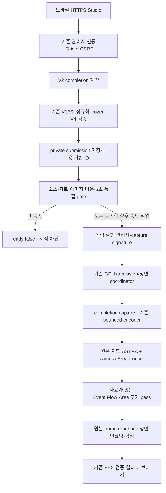

# Studio completion V2 — 실제 호출 경로

범위는 새 `universal-integration-completion-v2` 후보 소스다. 기존 FINAL·V4·이전 integration 소스는 수정하지 않는다. 아래 연결은 소스 및 CPU 증거이며 NVIDIA 프레임·MP4·사용자 품질 승인 증거가 아니다. 이미지 빌드·등록·독립 pull 상태는 최종 이미지 보고서에서 확인하며, 이 문서는 현재 gCube에 후보가 배포됐다고 주장하지 않는다.

## 입력부터 실행 gate까지

현재 필수 blocker가 남아 있으므로 위의 GPU 실행 가지는 실행되지 않았다. 도식의 향후 실행 경로가 현재 제작 허용을 의미하지 않는다.

| 단계 | 실제 진입점·소비자 | 전달·보호하는 정보 | 현재 증거 |
|---|---|---|---|
| HTTPS 서비스 | `studio_entry.Application` → 이전 HTTPS/proxy `Application` | 기존 관리자 로그인, HTTPS Origin, Host, CSRF. 인증 없는 새 제작 API 없음 | 실제 localhost HTTP 인증·CSRF·Host·Origin 테스트 |
| 자료 입력 | `StudioController._normal` → `contract_v2.normalize_submission` | inner `WORLD_ENGINE_STUDIO_PROMPT_V2`의 명시적 `completion` 선택 | 실제 계약 테스트·정확한 입력 receipt |
| 원본 검증 | 저장된 integration V1 계약 → 기존 Studio 계약 → 기존 backend `default_plan`·`bind_render_image`·`validate_render_plan` | 고정 V4 Scene·출처·이미지 바인딩, 80초·30fps·2,400프레임·12장면 | 실제 frozen backend CPU 검사. GPU admission 호출 없음 |
| metadata | `normalize_completion` + 기존 다섯 presentation 설정 | 원본 `videoPlan` 옆 `integration`·`completionV2`. source hash·승인은 runtime 소유 | 입력 검증·동일 Scene 비교 |
| private 저장 | 상속한 `_save_submission`·`_read_submission` | 전체 submission 및 lineage의 내용 기반 ID와 무결성. completion 변경 시 ID 변경 | private test-owned 저장·readback |
| 사전검사 | `_integration_gate` → `runtime_bridge.gate_context`·`data_admission` → 기존 `evaluate_render_gate` | 원본 closure, 자료 의미, 후보 이미지 포함, 필수 모듈, 정책 및 5초 사용자 승인 | readiness 차단 CPU 검사. native GPU health 호출 전 차단 |
| 시작·복구 | 기존 `start`·`resume` + 새 backend dispatch | owner consent·비용·시간·재시도·중복 실행 검사. 이전 claim 삭제 없음 | 직접 시작 차단·보호 검사 |

## metadata와 capture identity

`runtime_bridge.prepare_runtime_request`는 다음을 별도 private sidecar로 전달한다.

- `videoPlanSHA256`, `integration`, `completionV2`, immutable 이미지 참조.
- 현재·이전 source manifest SHA, 전역 반열린 프레임 규칙.
- 위 내용에 결합된 `captureSignature`, `oldCacheReuseAllowed:false`.

기존 Scene 자체를 편집하거나 완료된 예전 cache를 새 후보의 것으로 간주하지 않는다. `execution_manager`는 기존 관리자의 새 Python 인스턴스를 사용하며 `runtime_inputs/<captureSignature>`에 요청을 격리하고 작업 ID의 scope index를 유지한다. browser/terminal 재접속은 새 작업 시작 신호가 아니다. 복구·직접 호출도 `_authorize_start` 및 기존 GPU·비용 검사를 다시 통과해야 한다.

SFX-only child는 원래 capture scope와 동일한 video identity를 참조한다. metadata가 달라지면 `COMPLETION_REVISION_CAPTURE_CHANGED`로 차단한다. 이 경로의 CPU 검사는 실제 private sidecar/index 검사와 **명시적 no-worker spy**를 사용했다. 실제 GPU child나 인코딩 작업을 시작한 증거가 아니다.

## capture에서 실제 소비자로

1. `render_adapter.render_segment`는 기존 hardware·lease wrapper와 인코딩 경로를 사용한다. `studio_runtime`·`orchestrator`는 새 capture 진입점을 선택하는 얇은 adapter다. 기존 renderer 전체 복제본이 아니다.
2. `capture_runtime.loadLongRuntimePlan`은 현재·이전 manifest 및 요청 identity를 확인하고 기존 V4 `front.loadLongRuntimePlan`을 호출한다. frozen `document`와 실제 `frontProfile`을 그대로 가져온다.
3. `extendCompletionServerPlan`은 이전 integration server plan을 재사용하고 browser alias를 명시적으로 교체한다. `completionV2`, 자료 catalog, 실제 source observation에서 만든 frontier motion 및 무결성 hash를 runtime config에 추가한다.
4. `browser_adapter.bootLongRuntime`은 이 config의 profile·motion·catalog hash를 확인한 뒤 **원본 parent runtime**을 부팅한다. 새 profile을 선택했는데 binding이 없으면 오류이며 예전 runtime으로 조용히 돌아가지 않는다.
5. `production_camera_bridge` → `camera_extension`은 원본 V5 컴파일·평가와 기존 native camera factory를 재사용한다. `cameraApproachFrames`·settle·minimum hold를 소비한다. 안전 범위·연속성·장면 예산 실패는 차단한다. 임의 roll·강제 근접 줌을 새로 허용하지 않는다.
6. `production_area_bridge` → `frontier_extension`은 원본 Production Area owner를 감싸 실제 제공된 front observation과 전역 frame context에 결합한다. 중심선·주변광 스타일은 기존 다섯 presentation 설정을 사용한다. front가 없는 곳에 새 전선을 만들지 않는다. 고급 scalar 영토 셰이더와 terrain-aware golden lighting이 동일하게 연결됐다는 뜻은 아니다.
7. 추가 Event·Flow·Area가 있을 때만 `compileCompletionEventFlow` → `createCompletionEventFlowPass`가 기존 Event V1·Flow V2·Area V3 Core/renderer를 소비한다. canonical plan·실제 payload·자료 역할·SHA를 server catalog와 대조한다. 최종 제작 경로는 route를 숨기며 화살표·장식 경로를 추가하지 않는다.
8. 추가 pass는 원본 pipeline의 frame draw 안에서 원본 capture readback 전에 실행된다. 완성된 MP4나 screenshot 위에 지도를 덮는 방식이 아니다. 기존 protected graphic reservation과 boundary context가 없으면 필요한 합성을 차단한다. 실제 mobile 충돌·픽셀 품질은 GPU 영상에서 추가 확인해야 한다.
9. `assertCompletionFrame`은 global frame·profile identity와 실제 frontier owner 진단을 확인하고 기존 V4 frame assertion에 위임한다. 이 검사가 구현됐다는 사실과 실제 NVIDIA 프레임이 이 검사를 통과했다는 사실을 구분한다.

## 오디오·수정·결과 저장

기존 장면 coordinator·FFmpeg·SFX·결과 export를 재사용한다. 새 completion metadata는 렌더링 identity에 결합되며 SFX는 같은 전역 frame/sample 시간축을 사용한다. 원본이 지원하는 MP4·SHA·결과 receipt 검증과 저장 경계는 유지한다. `/world-storage` 내부 저장과 실제 Dropbox 외부 동기화·다운로드는 별도 증거가 필요하다.

`revision_bridge.plan_revision`은 기존 SFX-only 원본 함수에 위임하고 `videoPlan`·`integration`·`completionV2` 보존, 기존 영상 장면 전부 재사용, `requiresGpu:false`를 확인한다. 카메라·영토·전선의 자유 문장 구간 수정은 지원하지 않는다. 수정 가능한 경로가 구현돼 있어도 완료 parent·무결성·운영 gate가 없는 상태에서 제작을 허용하지 않는다.

## 증거 파일과 한계

- [CPU 검사 receipt](CPU_TEST_RESULTS.json): 실제 실행한 검사, 재사용한 결과, SHA와 GPU 제외 범위.
- [정확한 입력 검증](EXACT_INPUT_VALIDATION.json): 실제 frozen parser 경유 80초 입력 검증.
- [연결별 receipt](CONNECTION_RECEIPTS.json): source·field·factory·consumer·test의 연결. `SOURCE_STATIC`과 `CPU_INSTRUMENTED` 구분.
- [전체 151개 기능](FEATURE_LEDGER_151.json), [기존 미연결 53개](UNWIRED_LEDGER_53.json): 해당 기능의 실제 선택·자료·GPU 증거 상태.
- [역사 자료 admission](HISTORY_ADMISSION.md), [최소 누락 자료](MINIMUM_MISSING_DATA.json): 부분 전선과 양측 점령·부대 위치를 구분.

CPU trace는 렌더링 프레임이 아니다. Event/Flow가 빈 현재 입력에 그 기능이 화면에 나타났다고 표시하지 않는다. 미확보 역사적 국기·군대 위치·route·양측 점령 geometry를 만들지 않는다. 신규 5초/80초 GPU 렌더, gCube 배포, 과금, 사용자 품질 승인, FINAL 승격은 이 문서의 완료 범위가 아니다.
